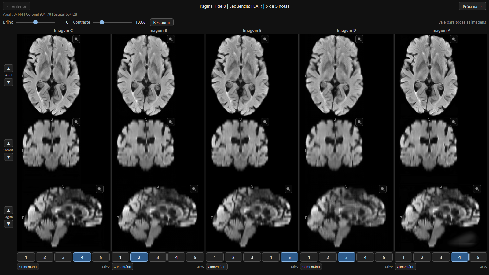
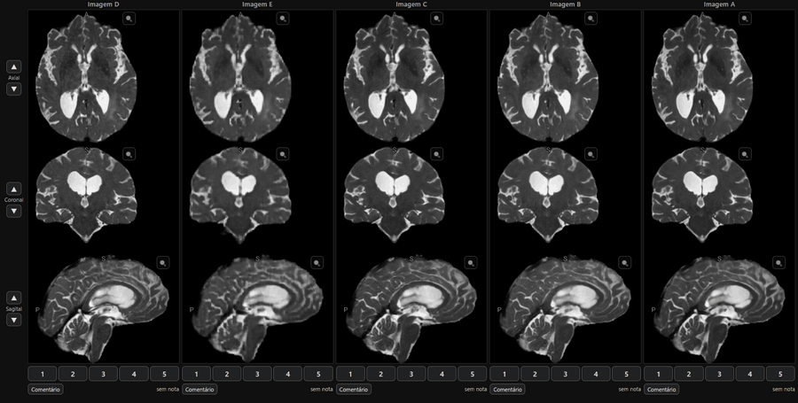
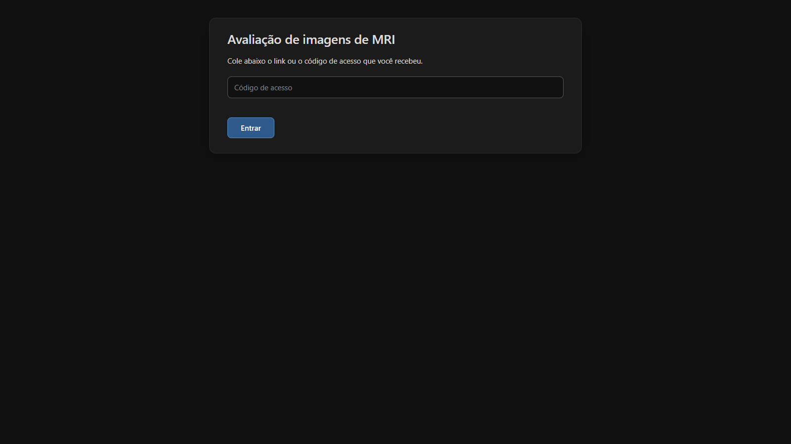
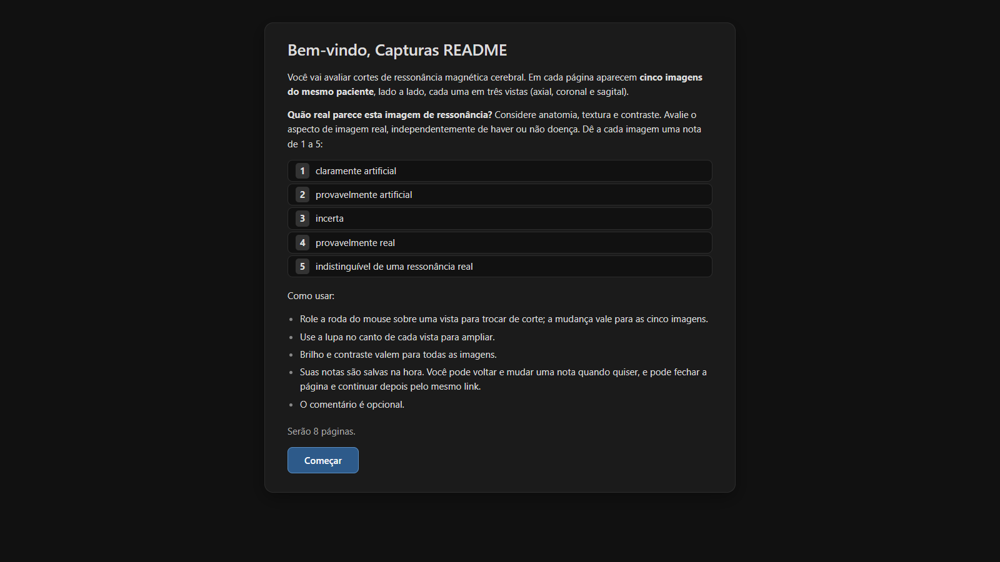
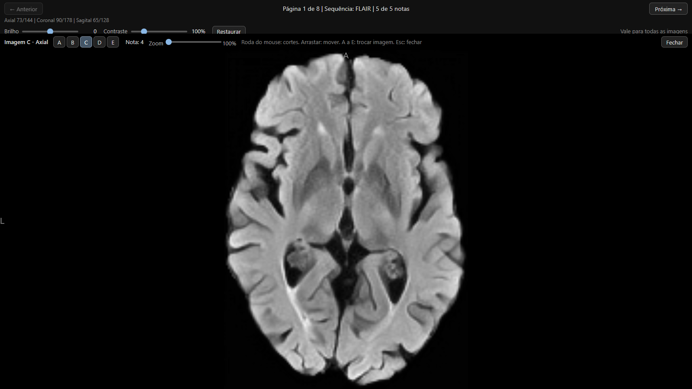
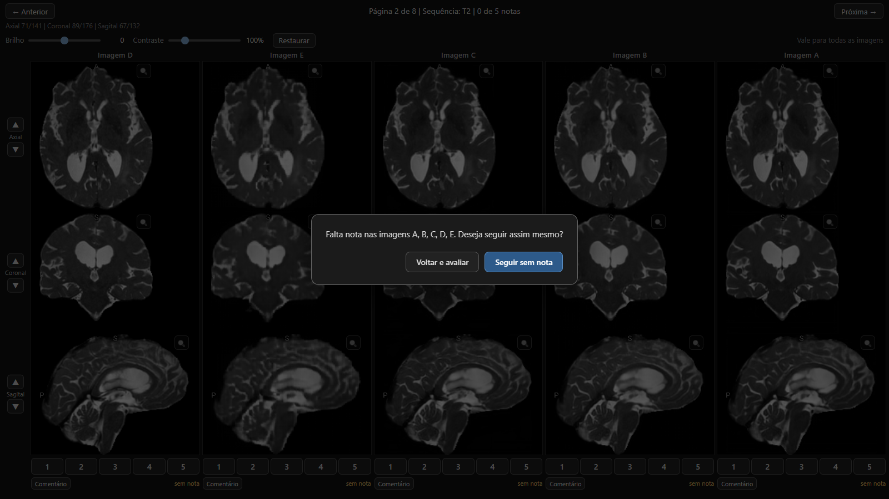

# MRI ValidationApp

Plataforma web para médicos avaliarem, **em condição cega**, o quão real parece um volume de ressonância magnética (MRI) cerebral. Cada caso traz cinco volumes 3D do mesmo paciente e da mesma sequência: o original e quatro reconstruções de autoencoder. O médico dá uma nota de 1 a 5 a cada volume, sem saber qual é qual.

Projeto de Iniciação Científica. As notas servem para comparar a fidelidade percebida das reconstruções com a do volume original.



<p>
  
  
  
  
</p>

## Como funciona

1. O médico recebe um link com um código de acesso pessoal.
2. Em cada página aparecem **cinco volumes** lado a lado, cada um em três vistas (axial, coronal e sagital). A ordem das colunas e das páginas é sorteada por médico.
3. A roda do mouse troca o corte de uma vista, e a mudança vale para as cinco imagens ao mesmo tempo. Brilho e contraste também são globais.
4. A lupa amplia uma vista, com zoom e arraste, e permite trocar de imagem sem perder o corte.
5. Cada nota é salva na hora. O médico pode voltar e corrigir, fechar a página e continuar depois pelo mesmo link.



*Rolar o corte muda as cinco imagens juntas, para o médico comparar a mesma região em todas.*

| Entrada | Instruções |
|---|---|
|  |  |

| Lupa | Aviso de nota faltando |
|---|---|
|  |  |

## Regras que o projeto nunca quebra

- **Cegamento.** O servidor e o navegador nunca recebem a origem de um volume. Só o `slot` (A–E). Nenhum nome de modelo aparece em URL, nome de arquivo, cabeçalho NIfTI, JSON ou log.
- **Gabarito fora do sistema.** O `answer_key.csv` nunca é lido pelo backend, nem entra no frontend, em imagem Docker ou em pasta servida. Só scripts de teste e de análise offline o leem.
- **Notas append-only.** Corrigir uma nota cria uma nova linha em `rating_event`. Não há `UPDATE` nem `DELETE` em notas.
- **Tamanho uniforme.** Os cinco volumes de um caso são servidos no mesmo formato e com o mesmo tamanho em bytes, porque o tamanho do arquivo poderia denunciar o original.

A conferência do cegamento está em [`docs/checklist-cegamento.md`](docs/checklist-cegamento.md).

## Stack

| Parte | Tecnologia |
|---|---|
| Frontend | Vite, TypeScript e [Niivue](https://github.com/niivue/niivue), sem framework de UI |
| Backend | Python, FastAPI, SQLModel e SQLite em modo WAL |
| Dados | `scripts/prepare_data.py` reempacota os volumes (inteiro de 16 bits, sem compressão, header limpo, IDs opacos) |

## Como rodar localmente

Pré-requisitos: Node e Python. Os volumes NIfTI e o gabarito não estão no repositório (ver [Dados](#dados)).

```bash
# 1. Preparar os dados (uma vez)
pip install -r scripts/requirements.txt
python scripts/prepare_data.py radiologist_grading_testkit/radiologist_grading_testkit/testkit data/prepared --force

# 2. Backend (porta 8000)
cd backend
pip install -r requirements.txt
python -m app.cli load-manifest
python -m app.cli create-rater --name "Fulano"      # imprime o token do médico
python -m uvicorn app.main:create_app --factory --port 8000
```

```bash
# 3. Frontend (porta 5173), em outro terminal
cd frontend
npm install
npm run dev
```

Abra `http://localhost:5173/?t=<token>`.

Para exportar as notas em CSV, defina `MRI_ADMIN_PASSWORD` antes de subir o backend e abra `http://localhost:8000/api/admin/export.csv` (usuário qualquer, a senha é a variável). Sem a variável, a rota fica desligada.

## Testes

```bash
python -m pytest backend scripts      # na raiz do repositório
python scripts/e2e_check.py           # médico simulado nos 8 casos, confere com o gabarito
cd frontend && npx tsc --noEmit       # tipos do frontend
```

## Estrutura

```
backend/    API FastAPI, modelos, sorteio, exportação, CLI
frontend/   Interface (Vite + TypeScript + Niivue)
scripts/    Preparação dos dados e teste ponta a ponta
docs/       Roadmap, decisões, nota técnica, checklist de cegamento
PLANO.md    Decisões e requisitos do projeto
```

## Documentação

- [`PLANO.md`](PLANO.md): objetivo, requisitos fechados e decisões em aberto.
- [`docs/ROADMAP.md`](docs/ROADMAP.md): tarefas e estado atual.
- [`docs/nota-tecnica.md`](docs/nota-tecnica.md): stack, hospedagem e biblioteca de visualização.
- [`docs/hospedagem-e-acesso.md`](docs/hospedagem-e-acesso.md): perguntas abertas sobre hospedagem.
- [`docs/decisions/`](docs/decisions): decisões registradas (viewer, backend, orientador).

## Estado

O MVP está pronto e roda localmente: todas as fases de 0 a 5 do roadmap foram concluídas, e a interface foi repaginada. Faltam decisões do estudo (desenho amostral, lote real de imagens e hospedagem) antes do piloto com 2–3 médicos. O detalhe está no [roadmap](docs/ROADMAP.md).

O foco é o uso em computador. Telefone está fora do escopo.

## Dados

As imagens nas capturas de tela vêm do conjunto de teste do projeto (`radiologist_grading_testkit/`, 8 casos reais). Os volumes e o gabarito não são versionados. As licenças e citações desses datasets ainda precisam ser revistas antes de qualquer divulgação além do uso local (ver P4 no roadmap).

A licença do código ainda não foi definida.
